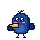
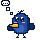
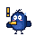
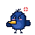
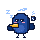
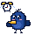
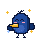

# Ворона Варя

Пиксельный маскот Doodle для ВШЭ. Вороны тащат в гнездо всё блестящее, а Варя тащит к себе дедлайны, пары и
оценки со всех учебных сайтов. Она реагирует на ситуации студента анимацией и короткой репликой.

<p>
  
  
  
  
  
  
  
</p>

## Как посмотреть

Демо-страница [index.html](index.html): живая Варя, все ситуации, три вида и галерея поз с кнопкой «Скопировать SVG».
Страница подключает `varya.js` из той же папки, поэтому открывай её через любой локальный сервер:

```bash
python3 -m http.server 8765 --directory mascot
```

и затем `http://localhost:8765`. Двойной клик по файлу тоже работает в большинстве браузеров.

## Что в папке

| Файл | Зачем |
|---|---|
| [varya.js](varya.js) | Вся Варя в одном файле без зависимостей: спрайт, анимации, ситуации и реплики |
| [index.html](index.html) | Демо-страница для просмотра и показа на защите |
| [sprites/](sprites) | Готовые статичные SVG: в покое, в колпаке и по одной позе на каждую ситуацию |
| [tools/export.mjs](tools/export.mjs) | Пересобирает `sprites/` из `varya.js` |

## Как использовать в приложении

### Статичная картинка

Подходит для иконок, пустых состояний, презентации и README. Бери файл из `sprites/` или собери SVG строкой:

```js
Varya.svg();                                        // в покое
Varya.svg({ situation: "deadline" });               // поза ситуации
Varya.svg({ theme: "pj" });                         // в ночном колпаке
Varya.svg({ eyes: "happy", props: ["spark"], size: 96 });
```

SVG масштабируется без потери чёткости: `shape-rendering="crispEdges"` держит пиксели квадратными.

### Живая Варя с реакциями

```html
<div id="varya" style="width:240px;aspect-ratio:1"></div>
<script src="varya.js"></script>
<script>
  const varya = Varya.mount(document.getElementById("varya"), {
    theme: "orig",                 // "day" | "orig" | "pj"
    situation: "deadline",
    onSay: (label, text) => showBubble(label, text),  // реплика после реакции
    onAnim: (anim) => {}                              // начало реакции и null в конце
  });
  varya.react();                   // сыграть реакцию и выдать следующую реплику
  varya.setSituation("night");     // сменить ситуацию: глаза, колпак и кружка
  varya.setTheme("pj");
  varya.destroy();
</script>
```

В React Mini App монтируй в `useEffect` и вызывай `destroy()` при размонтировании:

```tsx
useEffect(() => {
  const v = window.Varya.mount(ref.current!, { situation });
  return () => v.destroy();
}, [situation]);
```

Стили анимаций `mount` добавляет на страницу сам, один раз (`<style id="varya-css">`). Все классы начинаются с `varya`,
поэтому со стилями приложения они не пересекаются. При `prefers-reduced-motion` анимации выключаются.

## Ситуации

| id | Кнопка | Что делает Варя |
|---|---|---|
| `connect` | Подключить учёбу | Смотрит вверх, к ней слетается блестящее с учебных сайтов, она щёлкает клювом и проглатывает |
| `tip` | Совет | Наклоняет голову, над ней «?», потом по одному всплывают пузырьки мысли |
| `deadline` | Дедлайн | Трясётся, машет крыльями, глаза в точку, тень убегает без неё |
| `skips` | Пропуски | Злится: брови вниз, глаза-щёлочки, топает, над головой злая метка |
| `night` | Учёба ночью | В ночном колпаке и с кружкой кофе: клюёт носом, летят «z», резко просыпается |
| `class` | Скоро пара | Оглядывается, над ней звенит будильник, подпрыгивает |
| `done` | Всё сдано | Прыгает, хлопает крыльями, глаза-улыбки, вокруг искры |

Реплики лежат в `Varya.SITUATIONS[].lines`. Пока это заготовки; в приложении их стоит собирать из настоящих данных:
сколько осталось до дедлайна, сколько пропусков, какая следующая пара и в каком корпусе.

## Цвета

| Роль | Цвет |
|---|---|
| Тело | `#234B9B` |
| Тёмный бок, крылья | `#0F2D69` (основной синий ВШЭ) |
| Пузо | `#3A64B8` |
| Контур | `#0A1838` |
| Клюв | `#F6BC32`, нижняя половина `#E8A51C` |
| Румянец | `#F59AB8` |
| Обводка-стикер | `#FFFFFF`, 1 пиксель |

## Как менять

Спрайт рисуется кодом на сетке 32×32 в `drawCrow()` внутри `varya.js`. Координаты в пикселях спрайта, `(0,0)` в левом
верхнем углу, место под пузыри мысли и будильник есть выше и левее (до −8). Глаза — отдельные кадры в `eyes`,
предметы над головой — в `props`, реакции — CSS-классы `a-…` в константе `CSS`.

Новая ситуация: добавь объект в `SITUATIONS` (реплики, реакция, глаза по тактам, поза для превью) и описание в `GUIDE`.
После любых правок пересобери картинки и закоммить их вместе с кодом:

```bash
node mascot/tools/export.mjs
```
